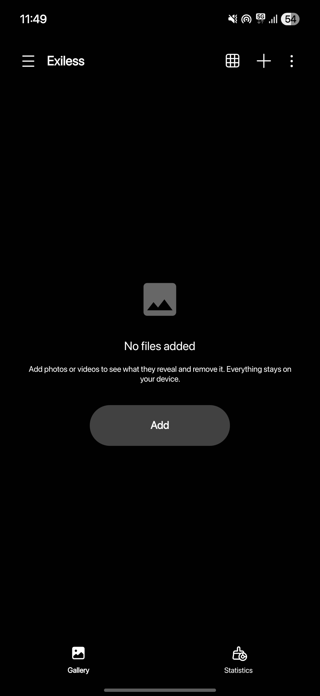
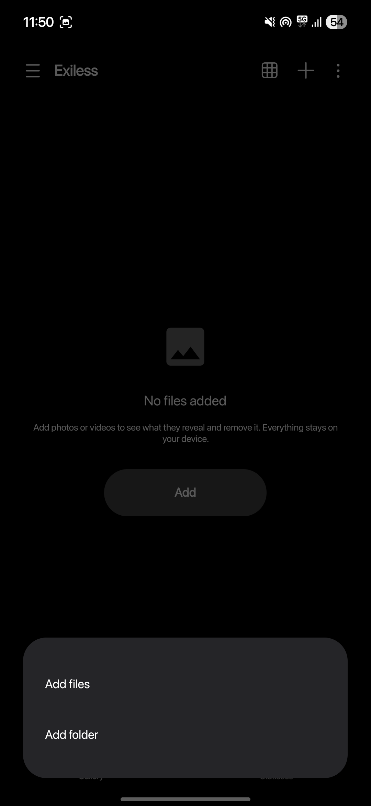
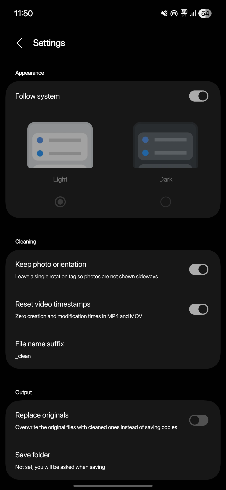
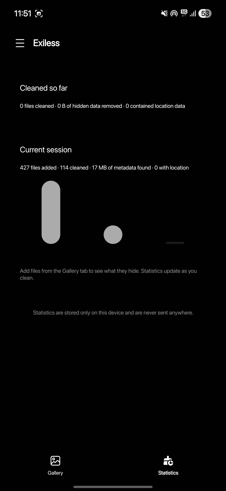

<div align="center">

<h1>Exiless</h1>
<p>Remove hidden metadata (EXIF, GPS, serial numbers, etc.) from photos and videos</p>
<p>Lossless, fully offline, no permissions</p>
</div>
<p align="center">
  <a href="https://github.com/rynekryz/exiless/stargazers"></a>
  <a href="https://github.com/rynekryz/exiless/tags"></a>
  <a href="LICENSE"></a>
  
  
</p>

---

## Screenshots

<div align="center">




</div>

---

## Building the APK

### Requirements
- Android SDK 36+ (or Android Studio)
- Java 21+
- Git
- A GitHub token with the `read:packages` scope, because the One UI libraries are published on GitHub Packages and even public packages need a token to download (free, read only, never expires unless you want it to): https://github.com/settings/tokens/new

### Build with Android Studio
1. Clone the repo and open it in Android Studio
2. Create a `github.properties` file in the project root (it is git ignored):
```
ghUsername=<your GitHub username>
ghAccessToken=<your token>
```
3. Wait for Gradle sync
4. Connect an Android device or use an emulator
5. Click **Run** to build and install

### Build from command line
```bash
git clone https://github.com/rynekryz/exiless.git
cd exiless
./gradlew assembleDebug
```
The same `github.properties` step applies here too, or you can put those two lines in `~/.gradle/gradle.properties` or use `GH_USERNAME` / `GH_ACCESS_TOKEN` environment variables instead.

APK location: `app/build/outputs/apk-named/debug/`, you get four builds (arm64, armv7, x86_64 and universal). Version number lives in `app/build.gradle.kts` (`appVersion`).

Unit tests for the metadata engine: `./gradlew :app:testDebugUnitTest`

## Features

- Removes EXIF, XMP, IPTC, GPS and other hidden metadata from photos and videos
- Lossless, the image data is copied byte for byte, never re-encoded
- See what is hidden before you clean: camera model, serial numbers, dates, GPS location, author, software tags and the total hidden size per file
- Open the GPS location of a photo in a map app (kinda scary when you see it)
- Batch clean many files at once
- Share target, so you can send photos from any app straight into Exiless
- Save cleaned copies to a folder you pick (system file picker) or share them directly
- Keeps photo orientation so your pics dont show sideways (leaves one single rotation tag)
- Keeps ICC color profiles and animation data
- Also removes JPEG thumbnails / MPF and data appended after the image, like the video part of motion photos
- Works with JPEG, PNG (incl. APNG), WebP (incl. animated), GIF, HEIC/HEIF/AVIF and MP4/MOV/M4V/3GP
- Grid or list layout
- Dark mode and light mode, follow system too
- Statistics of what you cleaned, stored only on your device
- One UI design (the Samsung look)
- Adaptive and themed (monochrome) icon
- No network access, no analytics, no permissions, nothing ever leaves your phone
- etc.

## License

Licensed under GPL-3.0-or-later. See [LICENSE](LICENSE) for details. Third party components: [THIRD_PARTY_LICENSES.txt](THIRD_PARTY_LICENSES.txt).

Not affiliated with Samsung. One UI is a trademark of Samsung Electronics.

<div align="center">
<strong>Made with ♥︎ by Ryne</strong>
</div>
<div align="center">
  <a href="https://discord.gg/YKhWXXhKmC"></a>
  <a href="https://tiktok.com/@rynekryz"></a>
</div>
