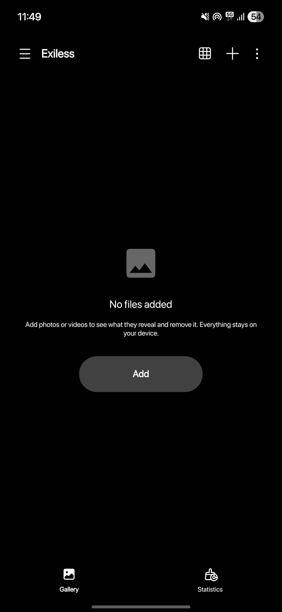
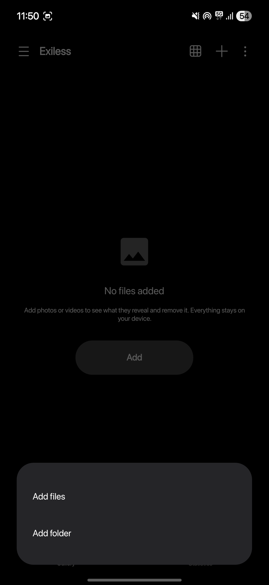
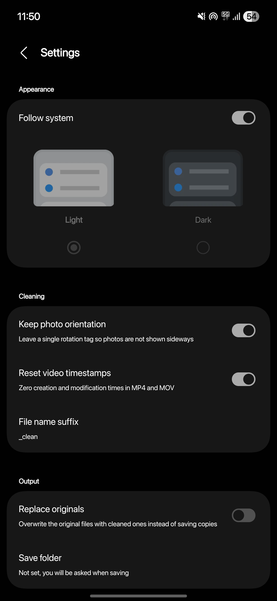
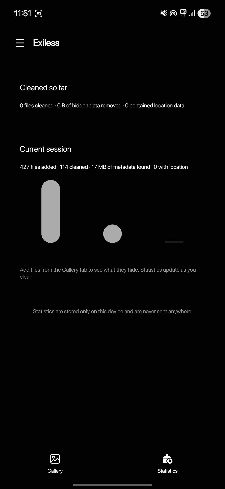

<div align="center">

<h1>Exiless</h1>
<p>Strips hidden metadata (EXIF, GPS, serial numbers, and friends) out of your photos and videos.</p>
<p>Lossless and fully offline, with no permissions and nothing leaving your phone.</p>
</div>
<p align="center">
  <a href="https://github.com/rynekryz/exiless/stargazers"></a>
  <a href="https://github.com/rynekryz/exiless/tags"></a>
  <a href="LICENSE"></a>
  
  
</p>

<p align="center">
  <a href="https://github.com/rynekryz/exiless/releases"></a>
</p>

---

## Screenshots

<div align="center">




</div>

---

## Features

- Removes EXIF, XMP, IPTC, GPS and other hidden tags from photos and videos
- Lossless: image data is copied byte for byte and never re-encoded
- See what's hidden before you clean: camera, serials, dates, GPS, author, software tags, and how much was hiding in there
- Open a photo's GPS spot in a map app (kinda scary when you see it)
- Batch clean a bunch of files at once
- Share target, so you can send photos in from any app
- Save cleaned copies to a folder you pick, or share them right away
- Keeps orientation so your pics don't show up sideways (one rotation tag stays)
- Keeps ICC color profiles and animation data
- Also clears JPEG thumbnails / MPF and whatever junk got appended after the image
- JPEG, PNG (incl. APNG), WebP (incl. animated), GIF, HEIC/HEIF/AVIF, MP4/MOV/M4V/3GP
- Grid or list view, with dark, light, or system theme
- Stats of what you cleaned, stored only on your device
- One UI look, plus an adaptive and themed icon
- No network, no analytics, no permissions, nothing ever leaves your phone
- etc.

---

## Technical Stack

- **UI:** One UI Design with Android Views and ViewBinding
- **Metadata:** custom JPEG, PNG, WebP, GIF, HEIF, TIFF and MP4 strippers
- **Language:** Kotlin
- **Build:** Gradle (Kotlin DSL) with a version catalog
- **Minimum SDK:** 26

---

## Building

You'll need Android SDK 36+ (or Android Studio), Java 21+, and a GitHub token with `read:packages`. The One UI libraries live on GitHub Packages, and even public packages need a token (free and read-only): https://github.com/settings/tokens/new

1. Clone the repo and open it in Android Studio.
2. Add a git-ignored `github.properties` in the project root:

```
ghUsername=<your GitHub username>
ghAccessToken=<your token>
```

3. Sync Gradle, connect a device, then hit **Run**.

Or build from the command line:

```bash
git clone https://github.com/rynekryz/exiless.git
cd exiless
./gradlew assembleDebug
```

The token can also go in `~/.gradle/gradle.properties`, or as `GH_USERNAME` / `GH_ACCESS_TOKEN`.

APK: `app/build/outputs/apk-named/debug/`, four builds (arm64, armv7, x86_64, universal). The version lives in `app/build.gradle.kts` as `appVersion`.

Tests: `./gradlew :app:testDebugUnitTest`

---

## Project Structure

```
Exiless/
├── app/src/main/java/com/rynekryz/exiless/
│   ├── core/
│   ├── data/
│   └── ui/
├── fastlane/
└── Screenshots/
```

---

## License

Licensed under GPL-3.0-or-later. See [LICENSE](LICENSE) and [THIRD_PARTY_LICENSES.txt](THIRD_PARTY_LICENSES.txt).

Not affiliated with Samsung. One UI is a trademark of Samsung Electronics.

<div align="center">
<strong>Made with ♥︎ by Ryne</strong>
</div>
<div align="center">
  <a href="https://discord.gg/YKhWXXhKmC"></a>
  <a href="https://tiktok.com/@rynekryz"></a>
</div>
